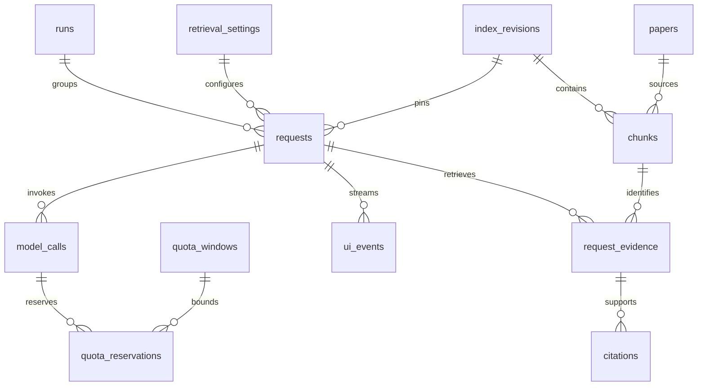

# The Relay database design

## F13–F16 implementation update

Golden dataset v2 is a versioned file-only draft: question ID, rubric/schema version, expected behaviour, reference evidence, citation/negative criteria and review state are stored in `data/evaluation_questions.json`; corpus hashes and dataset SHA are in its manifest. No DB migration or automatic run/grade import occurs. Existing v1 runs retain their original dataset hash and grades. See `data/GOLDEN_DATASET.md` for the evaluator-only boundary.

Actual schema version is 4. Numbered migrations remain in `src/relay/migrations.py`; earlier proposed migration names below are conceptual, not executable commands. Schema 4 adds `public_events(seq, request_id FK, created, event CHECK, payload JSON CHECK)`, an index on `(request_id,seq)`, and a unique partial index for one `done` per request. `local_metadata` holds the persisted cursor signing secret. Atomic request update plus public event insertion rolls back together on failure; a cancel/finalize race cannot publish two terminal outcomes. Startup recovery terminalizes interrupted requests and publishes their final event without repeating hosted work. Existing terminal records are backfilled with `done` only.

Corpus revisions remain immutable checksummed files, not duplicated into relational tables. Evaluation runs similarly use UUID folders with atomic manifest/summary replacement and append-only raw request JSONL; grading is a separate request-ID mapping with reviewer and rationale. The CLI refuses final exports with missing arrivals, duplicate IDs, incomplete runs or missing required grades. Interrupted file-based runs are visibly `running` until reviewed; export is blocked and a recovery command/explicit incomplete manifest is needed. No assertion of crash-safe exactly-once filesystem delivery is made.

Automatic seven-day retention, content tombstones/410, full diagnostic JSONL outbox delivery and concurrent grade editing are deferred. Public UI events themselves are a durable transactional outbox read directly by SSE; operational logs still use the bounded writer. No original PDFs, `.env`, or previous immutable indexes are deleted. Raw submission evidence is deliberately copied into a curated `evidence/` directory after checking it for secrets; databases, operational logs and caches remain untracked.

Status: F03 persistence foundation implemented and tested, November 12, 2026; remaining schemas below are target contracts. References: [PRD](PRODUCT_REQUIREMENTS.md), [API contract](API_DESIGN.md).

## 1. Storage architecture

Use local SQLite with one application process and one dispatcher. The F03 implementation uses Python sqlite3 repositories and numbered transactional migrations instead of the earlier proposed SQLAlchemy/Alembic stack. This keeps the existing small application and its transaction boundaries explicit without introducing an ORM solely for this foundation. FAISS and BM25 remain versioned files; no hosted database is required.

### Implemented foundation boundary

`relay.cli migrate` upgrades schema 1 (the legacy bootstrap) to schema 2 using `migrations.py`. Existing databases receive an integrity-checked SQLite backup before table reconstruction; failed migrations roll back data and version changes together. Repeated upgrades are no-ops with integrity checks. API startup checks the schema and fails on mismatch instead of migrating it. Future versions must add a new numbered migration; do not edit an applied migration.

Implemented tables: operations, requests, calls, events and schema_version. Operations give both user requests and explicit calibration probes a valid parent identity. Historical orphan probe IDs are preserved as legacy operations, not fabricated user questions. Calls/events reference operations; requests also reference operations. Unique idempotency, status/source/state enums, nonnegative usage, valid JSON, timestamp ordering and immutable terminal requests are enforced. History, quota-window and request-event indexes are present. Store repository methods own short connection/transaction scopes; no network call is made inside them.

The richer runs/corpus/citations/evaluation/UI-event tables below remain assigned to their owning later features. Full allowed-transition graphs, terminal payload checks, outbox replay and revision compatibility are not claimed by F03. The four migration groups below are a future roadmap, not the names of already applied migrations.

Enable `PRAGMA foreign_keys=ON` on every connection; SQLite does not enable enforcement automatically. Use WAL on a local filesystem and short transactions, with an initial 5-second busy timeout. WAL permits readers alongside a writer but still has a single writer; do not place the database on a network share. Pin a current patched SQLite runtime during implementation. Sources: [SQLite foreign keys](https://www.sqlite.org/foreignkeys.html), [SQLite WAL](https://www.sqlite.org/wal.html).

Never hold a DB write transaction across HTTP/model calls, embedding computation, file downloads or stream delivery. Bounded persistence failure produces service-unavailable and marks experiments incomplete; it must not silently bypass quota checks.

## 2. Shared conventions

F09–F12 update (November 13): no schema migration is required; schema remains 3. Request totals are derived from the existing calls ledger for both preparation and generation attempts, excluding released reservations. If any attempted call has missing usage, total prompt/completion counts are null, with known subtotals and the unknown-call count retained. This prevents a successful final generation from hiding the cost of earlier preparation/retry work. Terminal results still use the existing first-writer-wins update. Drafts are omitted from ordinary logging; the explicit live evaluation script stores them only under runtime/evaluation.

F04–F08 update: schema 3 adds provider_cooldowns keyed by real/stand-in source; atomic reservations check this persisted deadline. Startup recovers dispatched calls as unknown and releases only undispatched reservations. Known usage replaces estimates once per row; absent usage stays conservative. Cooldowns use UTC epoch values across restarts; local budgets remain conservative rolling windows, not claims about Groq reset semantics. Clock jumps remain a measurement caveat.

Corpus persistence currently uses immutable, checksummed JSON artifacts rather than duplicating extracted text in SQLite: runtime/corpus contains audits; each index revision includes pages.json, keywords.json, vectors.faiss and manifest.json. These are authoritative for F04–F06 provenance. The relational corpus tables below remain a later materialization option; F04–F06 do not claim they exist. Old revision folders are retained for historical citations.

Streamlit integration adds no UI database. It accesses SQLite only through FastAPI. Temporary UI state holds the API client, selected request, idempotency key and pagination cursors. Durable history, citations and runs live in SQLite. Browser refresh recovers via shared local history. No account, cookie or session-token persistence is needed.

- UUIDs represented as canonical text; UTC times stored as INTEGER epoch milliseconds and converted at API boundaries. Durations are nonnegative REAL milliseconds measured using a process-local monotonic clock.
- All fields required unless labelled nullable (`?`). PK = primary key; FK = foreign key; UQ = unique. JSON fields use validated versioned schemas and `CHECK(json_valid(field))` where supported by the pinned runtime.
- Enum strings use CHECK constraints. Application validation adds size limits and cross-table rules; do not pretend a normal CHECK can enforce other-table relationships.
- Counts and token values >= 0; unknown usage nullable; negative balances are allowed only for explicit observed-overdraw telemetry, never available admission credit.
- ON DELETE RESTRICT for corpus, experiment and request evidence relationships. Ephemeral child deletion is explicit. No broad cascades that erase experiment provenance.
- Mutation timestamps and optimistic `version` counters are mandatory on mutable resources. immutable configuration/index revisions are never edited in place.

## 3. Relationships

Interactive requests may have no run; benchmark requests must have one. Every request pins one index revision and one setting version. The original question is retained in request storage for the UI, not copied into operational logs.

## 4. Table specifications

### Local application identity

No principals, sessions or login-attempt tables. Requests, runs and history belong to the single local instance. An optional ephemeral UI tab identifier is not an authentication or privacy boundary. Idempotency is unique by endpoint/key within this instance.

### Corpus and retrieval

Initial chunking strategy is `recursive`, using a pinned token-counting length function and source page offsets. Store splitter type, separators, tokenizer/model revision, requested/effective chunk cap, overlap and page-boundary policy in retrieval config/index manifests. Validate embedding and query-plus-document reranker limits before publication. Semantic/structure-aware strategies are deferred; future strategies create new setting/index revisions through the same schema, not mutations of existing chunks.

**papers:** `id PK`, `arxiv_id`, `arxiv_version`, `title`, `pdf_sha256`, `relative_pdf_path`, `page_count`, `verified_at?`, `created_at`. UQ `(arxiv_id,arxiv_version)`, CHECK page_count > 0. Enforce the fixed allowlist: 1706.03762/v7, 2410.00037/v1, 2507.07955/v2. Paths are generated beneath a configured data root; never accepted from a browser. Checksum mismatch blocks ingestion; do not overwrite pinned bytes.

**paper_pages:** `paper_id FK`, `page_number`, `text`, `text_sha256`; composite PK `(paper_id,page_number)`, CHECK page_number >= 1. Ingestion validates page_number <= papers.page_count.

**retrieval_settings:** `id PK`, `name` (R1/R2/R3), `revision INTEGER`, `config_json`, `config_sha256`, `created_at`; UQ `(name,revision)`. Validate chunk_size > overlap >= 0, positive bounded top-k, reranker input/token limits, known embedding/reranking model revisions, fusion constant > 0. Immutable once used by a request/run.

**index_revisions:** `id PK`, `setting_id FK`, `state`, `manifest_json`, `artifact_relative_path`, `artifact_sha256?`, `created_at`, `ready_at?`, `failure_code?`. State building/ready/failed/retired. Manifest records PDF checksums, extraction version, embedding model/revision/dimension, distance metric, normalization, chunking, and FAISS-position-to-chunk mapping. Ready requires verified artifact hash and counts. Keep retired versions while references remain.

**active_indexes:** `setting_id PK/FK`, `index_revision_id FK`. Application ensures revision belongs to setting and is ready; this table is atomically switched after a new build is validated.

**chunks:** `id PK`, `index_revision_id FK`, `paper_id FK`, `ordinal`, `page_start`, `page_end`, `section?`, `text`, `text_sha256`, `token_count`, `vector_position?`. UQ `(index_revision_id,paper_id,ordinal)`, UQ `(index_revision_id,vector_position)` for non-null vector positions. CHECK ordinal >= 0, page_start >= 1, page_end >= page_start, token_count > 0. Ingestion checks page_end <= paper page count. A new index receives new chunk IDs; UI citations always retain exact revision IDs. Index `(paper_id,index_revision_id,page_start)`.

### Runs and requests

**runs:** `id PK`, `source` real/stand-in, `scenario`, `state` created/running/stop_requested/completed/failed/incomplete, `config_json`, `seed?`, `created_at`, `started_at?`, `ended_at?`, `evidence_complete` boolean, `version`. Config freezes arrival schedule, quota profile, model/settings, code revision, percentile method and cost basis. CHECK completion has ended_at and evidence_complete. Run transitions created -> running -> completed; running -> stop_requested -> completed; nonterminal -> failed/incomplete. Recovered interrupted runs become incomplete.

**requests:** `id PK`, `run_id? FK`, `parent_request_id? FK requests`, `idempotency_key`, `body_sha256`, `status`, `route?`, `question?`, `refined_query?`, `clarification_question?`, `answer?`, `reason_code?`, `source`, `model`, `setting_id FK`, `index_revision_id FK`, `created_at`, `updated_at`, `deadline_at`, `terminal_at?`, `content_expires_at`, `content_purged_at?`, `version`.

UQ `(idempotency_key)`. Status CHECK enumerates the API states. CHECK deadline_at > created_at; terminal status iff terminal_at is non-null. Answer text only allowed for answered status; answered must have text unless explicitly purged; clarification must have question unless purged. Store refused explanatory text in a separate nullable `display_message` field. Service transaction verifies parent state, revision-setting compatibility and source matches run. `received` rows for admission failures may pin the selected ready revision before queue admission; pre-validation failures are audit events only.

Indexes `(created_at DESC,id DESC)`, `(status,created_at DESC,id DESC)`, `(run_id,created_at,id)`, and partial `(created_at,id) WHERE status='queued'`. Request-state transitions are exactly those in API section 6, enforced by service transition helper with compare-and-swap, never arbitrary status assignment. Terminal rows cannot be reactivated.

**request_metrics:** `request_id PK/FK`, `first_model_token_ms?`, `first_token_ms?`, `total_ms?`, `queue_ms`, `refinement_ms`, `retrieval_ms`, `rerank_ms`, `retry_ms`, `retries`, `known_input_tokens`, `known_output_tokens`, `cached_input_tokens?`, `usage_complete` boolean, `peak_queue_length`, `csv_status?`. CHECK numeric counts/durations nonnegative; csv_status null or ok/rate_limited/timeout/error. API clarifications/refusals map to ok execution status but remain separate product outcomes. Cancelled/deadline -> timeout; failed -> error. Grades never derive from execution status. First emission timing can be written once after terminal computation; use conditional null update and never let SSE replay reset it.

**model_calls:** `id PK`, `request_id FK`, `stage` preparation/generation, `attempt` 1..3, `status` reserved/dispatched/succeeded/failed/unknown, `provider_request_id?`, `started_at?`, `ended_at?`, `http_status?`, `error_code?`, `finish_reason?`, `estimated_input_tokens`, `completion_cap`, `actual_input_tokens?`, `actual_output_tokens?`, `cached_input_tokens?`, `first_content_ms?`. UQ `(request_id,stage,attempt)`. At most one logical call per stage with up to two transport retries. No new attempt after a successfully completed candidate. A crash after dispatch can leave unknown usage; do not automatically repeat such a call on restart.

**request_evidence:** `request_id FK`, `chunk_id FK`, `bm25_rank?`, `vector_rank?`, `rrf_score?`, `reranker_score?`, `selected` boolean, `context_order?`; composite PK `(request_id,chunk_id)`. Positive ranks; unique selected context order per request via partial unique index. Service verifies chunk revision equals request revision and limits context token count. Final evidence immutable after generation dispatch.

**citations:** `request_id`, `chunk_id`, `ordinal`, `answer_start`, `answer_end`; PK `(request_id,ordinal)`, composite FK `(request_id,chunk_id)` -> request_evidence. CHECK ordinal >= 0, answer_start >= 0, answer_end > answer_start. Offsets are Unicode code points (frontend must convert to UTF-16 if needed). Finalization checks chunk was selected, offsets fit answer, and cited claims have expected coverage. This proves provenance/format only, not entailment.

### Events, evaluation and quota accounting

**ui_events:** `request_id FK`, `seq`, `type`, `payload_json`, `created_at`; PK `(request_id,seq)`. Type status/answer_delta/citations/clarification/error/done. Persist before publishing; sanitized public payloads only. Per-request sequence allocated transactionally. A partial unique index on request_id where type=done allows one terminal stream event. Late delivery metrics do not alter done or replay sequences.

**audit_events:** `event_id PK`, `run_id? FK`, `request_id? FK`, `call_id? FK`, `service`, `event_name`, `level`, `timestamp`, `elapsed_ms?`, `span_id?`, `parent_span_id?`, `attributes_json`, `exported_at?`. Append-only event/outbox for required state transitions, model lifecycle and quota decisions. Index `(request_id,timestamp,event_id)`, `(run_id,timestamp,event_id)`, and partial unexported index. Optional high-frequency DEBUG/chunk timing goes through the bounded JSONL writer, not a DB write for every token. Benchmark capture settings are frozen in the manifest.

**evaluation_questions:** `id PK`, `version`, `question`, `expected_answerability`, `reference_evidence_json`, `rubric_version`; frozen before comparing settings. **grades:** `request_id PK/FK`, `question_id FK`, `grade` correct/wrong/refused_correctly/refused_wrongly, `grader`, `rationale`, `graded_at`, `version`. Missing grades remain absent, not fabricated defaults. Grade updates emit audit events with prior/new values. Failed executions without answers can remain ungraded and make a complete-quality export unavailable until the reporting policy is explicitly resolved.

**quota_windows:** `id PK`, `scope`, `model`, `dimension` rpm/tpm/rpd/tpd/itpm/otpm, `window_start`, `reset_at`, `limit_value`, `consumed`, `reserved`, `observed_remaining?`, `observed_at?`, `version`; UQ `(scope,model,dimension,window_start)`. CHECK reset_at > window_start and limit/counts >= 0. Scope distinguishes real organization/project from stand-in. No cross-backend pooling. Account observations are recorded separately from estimates.

**quota_reservations:** `call_id FK`, `window_id FK`, `amount`, `actual_amount?`, `state` held/consumed/released/uncertain; PK `(call_id,window_id)`. Values nonnegative. All dimensions for a call are reserved together or none. A cancelled unsent call releases holds; dispatched-but-unknown holds remain conservative until reset/reconciliation. If actual usage exceeds reservation, record full actual usage and block further work if overdrawn.

Minute admission also checks the timestamped call/reservation ledger over the previous 60 seconds so a fixed-window boundary does not permit a double burst. Daily reset is provider/config driven. Token estimates are reconciled from known usage; uncaptured output is never assumed free. The stand-in keeps its own ledger/database or isolated memory profile, never reuses the application's reservation counters.

## 5. Transaction boundaries

| Transaction | Atomic changes / concurrency rule |
| --- | --- |
| Submit | BEGIN IMMEDIATE; check idempotency, ready index and queue capacity, insert request/metrics and admission event; commit before waking dispatcher |
| Claim job | Conditional queued -> preparing/retrieving and increment version; one worker claims once |
| Reserve call | BEGIN IMMEDIATE; recheck all quota dimensions, insert call/reservations and quota event; commit before HTTP dispatch |
| Mark dispatched | Persist dispatched state before HTTP; a crash in the subsequent uncertain interval is treated conservatively |
| Reconcile call | Conditional final call update, quota adjustments, metrics and event; repeated reconciliation is idempotent |
| Finalize | Conditional nonterminal -> terminal, answer/refusal, citations, metrics, public events and audit record in one transaction; no partially published answer |
| Cancel | Conditional terminal transition; release only unsent reservations, signal active task after commit; late provider usage updates ledger only |
| Export logs | Read outbox, append by event_id to JSONL, mark exported; crash may duplicate a line, consumers deduplicate by event_id |
| Index publish | Build outside DB, validate files/checksums, atomically rename directory on same volume, then commit ready revision + active pointer |
| Grade | Check expected version, update grade and append audit event; concurrent edits conflict |

Use bounded retry for SQLITE_BUSY, not unbounded waiting. No claim of distributed exactly-once Groq execution: local idempotency prevents duplicate submission, but remote completion after a lost connection remains uncertain.

## 6. Index consistency and recovery

Every request pins the active revision on admission; a later index switch never changes its evidence. Startup validates active artifact checksums, dimension and ID mapping. If absent/corrupt, mark readiness unavailable; do not silently serve from a mismatched index. Build failures leave the old ready revision active. Unreferenced staged directories are eligible for a later cleanup command after validation.

On restart, queued jobs within deadlines may resume; jobs that expired become timed_out. Interrupted active jobs become failed with `process_interrupted`, calls potentially dispatched become unknown, runs become incomplete. Do not repeat generation automatically when its remote status is uncertain. Reconcile missing terminal events from durable records and replay the outbox. SQLite and artifacts require a consistent backup (SQLite backup API plus immutable artifact manifest), not copying an actively written DB file alone.

## 7. Retention and exports

Proposed interactive content retention: seven days; idempotency minimum 24 hours and never less than an active request lifetime. On content purge, remove question/refinement/answer/clarification/display_message and content-bearing public events/citation offsets, set content_purged_at and preserve metrics. GET content returns 410. Benchmark evidence is retained through submission.

Keep benchmark corpus, questions, grades, manifests and evidence through submission. No automatic purge of referenced chunks or benchmark runs. Operational logs exclude question/answer text; DB content needed by the UI has a narrower access boundary. Protect local storage by OS permissions; encryption at rest is not claimed unless implemented.

Export one CSV row per offered request, including admission failures. Original required fields remain; additive fields or companion manifest are necessary for settings, arrival schedules, peak queue and cost provenance. A CSV-only requirement conflict must be resolved before submission. Build latency percentiles from explicitly stated populations, record missing usage and ungraded rows, never substitute zero. A stopped run with missing expected arrivals is incomplete, not a successful short run. Preserve failed and retry costs if known.

## 8. Migration sequence and checks

1. `0001_foundation`: migration metadata and local database configuration; no identity schema.
2. `0002_corpus`: papers/pages, settings, revisions, chunks, active pointers. Seed only exact required paper identities/settings, not fabricated extracted data.
3. `0003_runtime`: runs, requests, metrics, model calls, evidence, citations, UI/audit events, quotas and reservations.
4. `0004_evaluation`: questions, grades, exporter views and indexes.

Migrations are local CLI tasks before API startup; refuse readiness on schema mismatch. Take a verified backup before destructive migrations, run foreign_key_check and integrity_check after migration, and restore backup rather than claiming lossy downgrade safety. New nullable columns can be added and backfilled; enforce NOT NULL only after validation. Never mutate immutable chunk IDs to retrofit a changed extraction algorithm.

Acceptance checks: clean install and repeat upgrade; FK violations; enum/range constraints; duplicate keys; invalid parent request; revision mismatch; parallel queue admission/reservation; terminal cancel/finalize race; duplicate usage reconciliation; crash between file publication and pointer switch; outbox replay deduplication; pagination ties; unknown usage preservation; retention without benchmark loss; source citations remain resolvable after reindexing. These are required implementation tests, not tests already run.

## 9. Decisions still requiring evidence

Actual Groq limits/reset semantics; refinement/completion token budgets; observed machine capacity and reranker latency; benchmark CSV extension acceptance; chosen pinned dependency versions. The small SQLite/single-instance design is sufficient for the assignment; multiple web workers or public multi-user deployment would require explicit redesign of admission coordination, access control and persistence concurrency.
